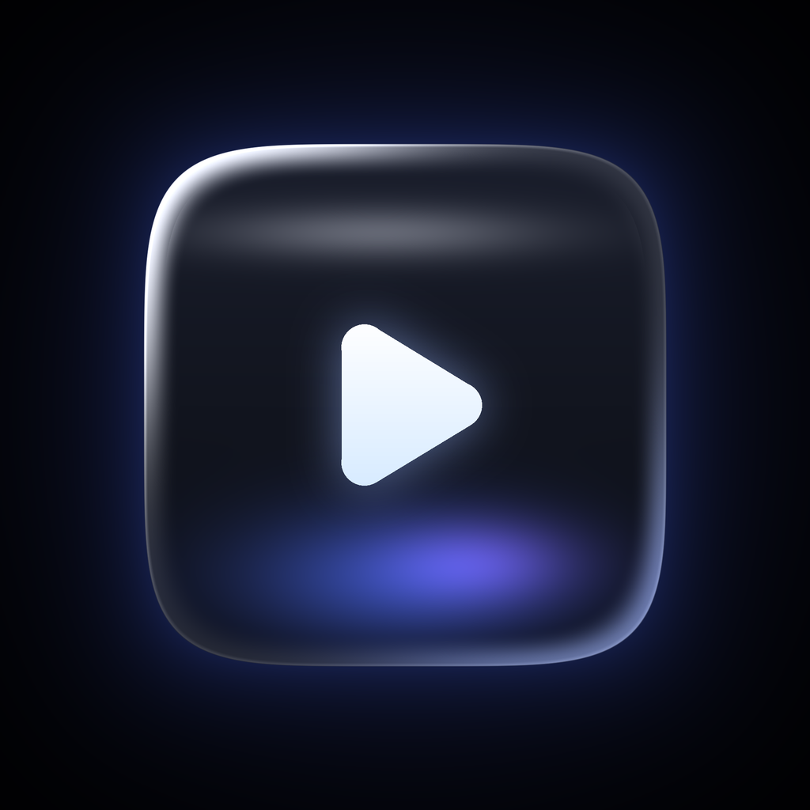
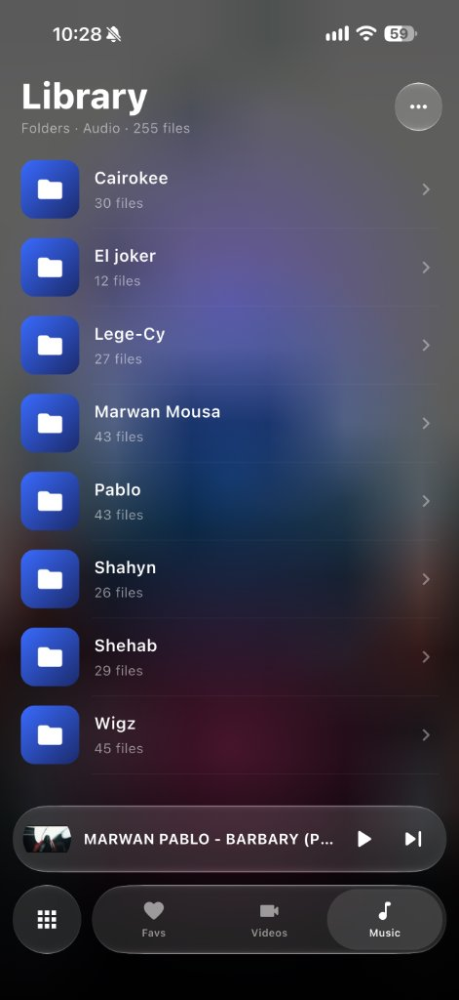
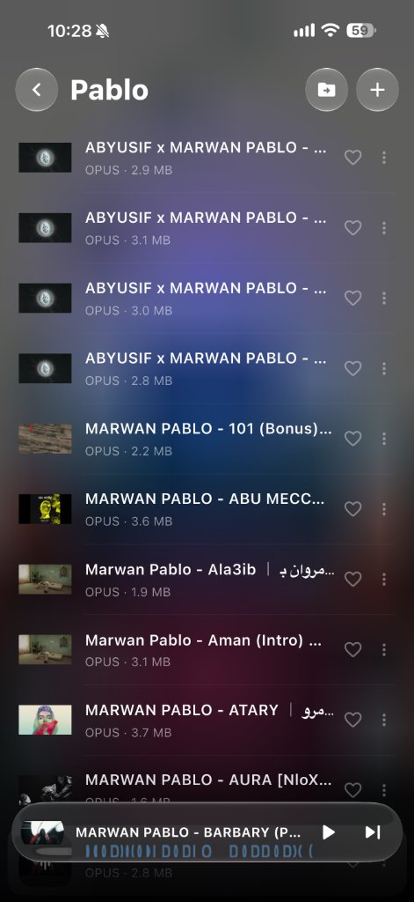
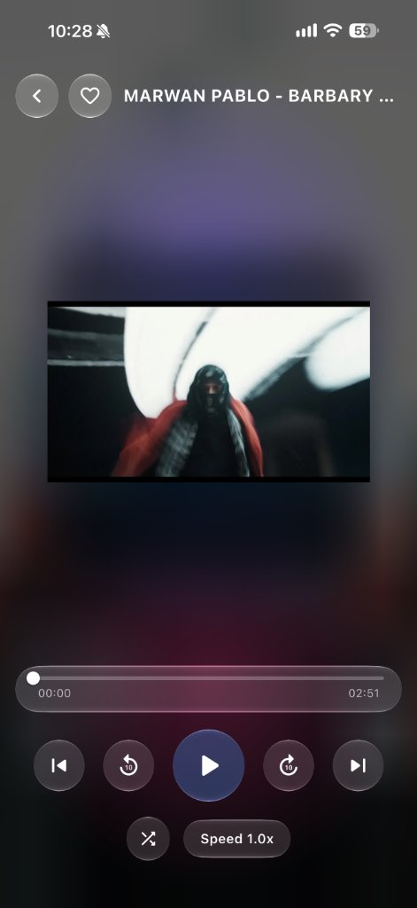
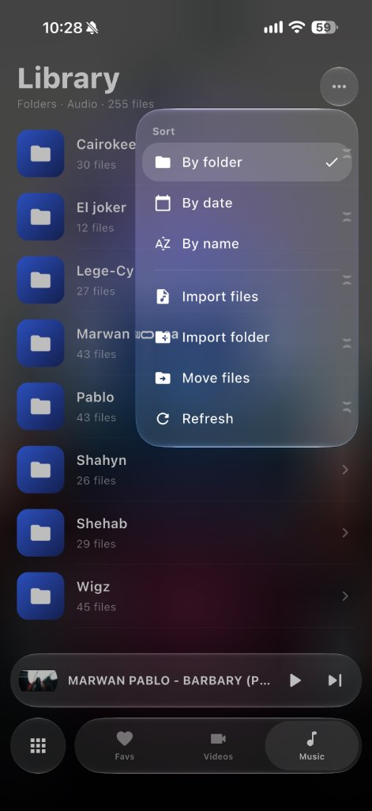
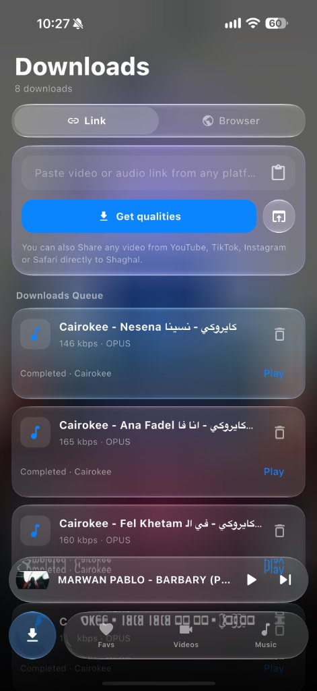
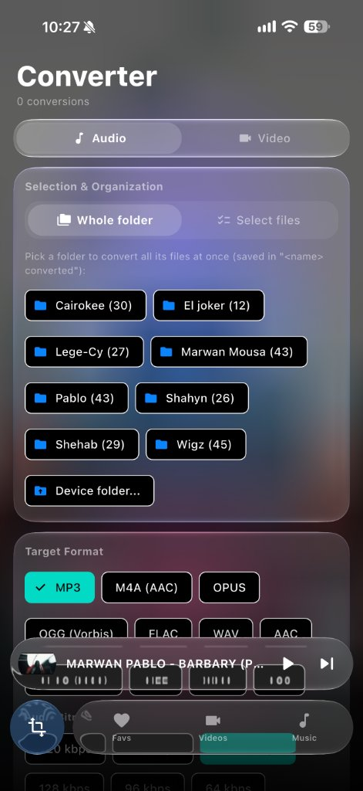
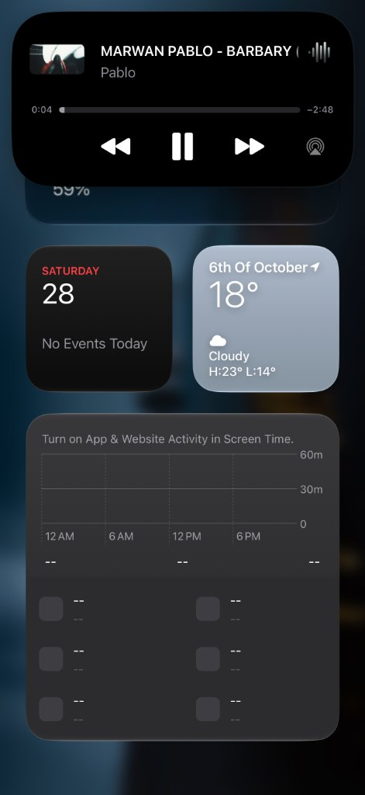

<div dir="rtl">

<p align="center">
  
</p>

<h1 align="center">Shaghal - شغل</h1>

<p align="center"><a href="README.md">English</a> · <b>العربية</b></p>

مشغّل صوت وفيديو ومُحمّل ومُحوّل صيغ للـ iPhone بثيم أسود وتصميم Liquid Glass، مبني بـ Flutter. بيشغّل تقريباً أي صيغة ومنها `.opus` و`.flac` و`.ogg` و`.mkv` و`.webm`، وبيرتّب مكتبتك زي ما بتحتفظ بيها فعلاً: **فولدر لكل فنان**.

## لقطات الشاشة

<p align="center">
  
  
  
  
</p>

<p align="center">
  
  
  
</p>

## المميزات

- **بيشغّل (تقريباً) كل حاجة.** معتمد على [media_kit](https://pub.dev/packages/media_kit) (libmpv / FFmpeg)، فالصيغ اللي AVPlayer في iOS بيرفضها زي OPUS وMKV وFLAC وOGG وWebM بتشتغل مباشرة من غير تحويل.
- **تحكم كامل وحفظ موضع التشغيل.** تشغيل في الخلفية، تشغيل عشوائي (Shuffle)، التحكم في سرعة التشغيل (`0.5x`–`2.0x`)، تقديم/ترجيع 10 ثواني، تشغيل قوائم، وحفظ آخر تراك وموضع التشغيل تلقائياً بعد المكالمات أو إعادة فتح التطبيق.
- **مكتبة مبنية على الفولدرات وإدارة الملفات.** تصفح حسب فولدرات الفنانين (والفولدرات المتداخلة)، فرز بـ **التاريخ** أو **الاسم**، مفضلة، **سحب لليسار لحذف أي ملف** مع تأكيد، و**نقل ملف واحد أو عدة ملفات** بين الفولدرات أو إنشاء فولدرات جديدة.
- **Liquid Glass حقيقي وثيمات متعددة.** على iOS 26+ الهيدر وميني بلاير والمشغّل والقوائم وشريط التابات بتستخدم زجاج Apple النيتيف (عبر [liquid_design](https://pub.dev/packages/liquid_design)) مع اختيار نمط الزجاج (**شفاف / عادي**) والمظهر (**داكن / فاتح / زي النظام**).
- **مُحمّل مدمج ومتصفح داخلي.** الصق أي رابط أو افتح تبويب **المتصفح الداخلي** لسحب الروابط واختيار جودة الفيديو أو الصوت والصيغة والبترايت وفولدر الحفظ، مع دعم التحميل المقطّع ليوتيوب وHLS وحفظ صورة الغلاف، وإمكانية ربط سيرفر استخراج خارجي (مثل Cobalt أو yt-dlp) من الإعدادات.
- **مشاركة عدة روابط متتالية (Multi-Link Share Queue).** اعمل **مشاركة ← Shaghal** لكذا رابط ورا بعض من يوتيوب أو سفاري أو تيك توك أو إنستغرام من غير ما تخرج من التطبيق. الروابط بتتجمع في قائمة انتظار داخل شغال وبتتجهز جوداتها في الخلفية، وتقدر تعدّي عليها **واحد تلو الآخر (`تجهيز الكل`)** تختار لكل رابط فيديو ولا صوت وجودته وفولدَر الحفظ.
- **محوّل الصوت والفيديو دفعة واحدة.** معتمد على FFmpeg (`ffmpeg_kit_flutter_new`). حوّل فولدر كامل مرة واحدة (في `<اسم الفولدر> converted`) أو اختر ملفات محددة من مكتبتك أو جهازك بين `MP3` و`M4A (AAC)` و`OPUS` و`OGG` و`FLAC` و`WAV` و`AAC` و`MP4` و`MKV` و`MOV` و`WEBM` و`AVI` وغيرها.
- **الصور المصغّرة ومركز التحكم.** استخراج غلاف الألبوم لملفات الصوت ولقطة معاينة للفيديو مع كاش على القرص، وتحكم كامل من Control Center وشاشة القفل مع اسم الفنان (من اسم الفولدر) وAirPlay وأزرار السماعات.
- **واجهة عربي وإنجليزي.** تبديل فوري بين العربية والإنجليزية مع دعم RTL / LTR بالكامل.
- **استيراد من التطبيق ومن «الملفات».** استورد ملفات أو فولدرات من جوه التطبيق أو عبر **الملفات ← على الـ iPhone ← Shaghal**.

## الصيغ المدعومة

الماسح بيتعرّف على الامتدادات دي (وتقدر تضيف غيرها في [`lib/core/media_formats.dart`](lib/core/media_formats.dart)). التشغيل نفسه عن طريق FFmpeg، فأي حاجة يقدر يفك تشفيرها هتشتغل.

| النوع | الامتدادات |
|-------|------------|
| صوت | mp3, m4a, aac, wav, flac, ogg, oga, **opus**, wma, aiff, aif, aifc, caf, amr, ape, wv, mka, mpc, dsf, dff, alac, mp2, ac3, eac3, dts, tta, m4b, m4r, spx, mid, midi, weba |
| فيديو | mp4, m4v, mov, mkv, avi, webm, wmv, flv, ts, mts, m2ts, 3gp, 3g2, mpg, mpeg, ogv, vob, divx, asf, rm, rmvb, f4v, mxf |

## إزاي المشروع مبني

الـ repo بيضم كود Dart (`lib/`) والملفات المساعدة وقوالب iOS الخاصة بالـ Share Extension وجسر AVFoundation (`ios_templates/`) وسكريبتات الإعداد (`setup.sh` / `setup.ps1`) لتوليد مجلد `app/` تلقائياً.

| الوظيفة | المكتبة / المكون |
|---------|-------------------|
| التشغيل | `media_kit`, `media_kit_video`, `media_kit_libs_*` |
| إدارة الحالة | `flutter_riverpod` |
| Control Center وشاشة القفل | `audio_service`, `audio_session` |
| واجهة الزجاج | `liquid_design` |
| التحميل والمتصفح والروابط | `youtube_explode_dart`, `dio`, `webview_flutter`, `app_links` |
| التحويل والدمج | `ffmpeg_kit_flutter_new` + `ShaghalBridge.swift` |
| الأغلفة والصور المصغّرة | `audio_metadata_reader`, `video_thumbnail` |
| قائمة انتظار المشاركة | `ios_templates/ShareExtension/ShareViewController.swift` |
| الاستيراد والأيقونة | `file_picker` (الإصدار 10), `flutter_launcher_icons` |

```text
lib/
  main.dart                    نقطة البداية والـ deep links وقائمة المشاركة
  core/media_formats.dart      الامتدادات المعروفة للصوت والفيديو
  models/
    media_item.dart            نماذج الملفات والفولدرات
    download_item.dart         مهام التحميل وصيغ الاستخراج وقائمة الانتظار
    convert_item.dart          مهام وصيغ التحويل
  services/
    library_scanner.dart       مسح الفولدرات في isolate
    importer.dart              استيراد الملفات والفولدرات
    thumbnails.dart            الأغلفة ولقطات الفيديو وكاش القرص
    audio_handler.dart         الربط مع Control Center وشاشة القفل
    media_extractor.dart       تحليل الروابط وجلب الجودات
    download_manager.dart      إدارة قائمة الانتظار والتحميل المقطّع وHLS والغلاف
    hls_downloader.dart        تحميل بث HLS
    media_converter.dart       محوّل FFmpeg الدفعي
    native_bridge.dart         جسر MethodChannel والـ App Group مع iOS
  state/providers.dart         الـ providers والفرز والمفضلة والمشغّل والنقل والحذف
  ui/
    glass.dart                 الخلفية والأسطح الزجاجية
    artwork.dart               ويدجت الصور المصغّرة
    library_page.dart          المكتبة والفولدرات والنقل والسحب للحذف والإعدادات
    now_playing.dart           شريط التشغيل والمشغّل الكامل (السرعة/العشوائي)
    download_page.dart         شاشة التحميل والمتصفح الداخلي وقائمة انتظار الروابط
    converter_page.dart        شاشة التحويل الدفعي
    legal_page.dart            صفحة الشروط
ios_templates/
  Runner/ShaghalBridge.swift   جسر AVFoundation والـ App Group
  ShareExtension/              امتداد iOS Share Sheet لتجميع الروابط في الطابور
  configure_ios.rb             ضبط الـ target والصلاحيات في Xcode
assets/icon/icon.png           أيقونة التطبيق (1024x1024)
setup.sh / setup.ps1           سكريبتات توليد المشروع
.github/workflows/ios.yml      البناء على CI (IPA غير موقّعة)
```

## البدء

### الطريقة (أ): بناء IPA على السحابة (من غير Mac)

1. ارفع الـ repo على GitHub.
2. افتح **Actions ← Build iOS (unsigned IPA) ← Run workflow**.
3. نزّل الملف `Shaghal-ipa` من الـ artifacts بعد انتهاء البناء.

### تركيب الـ IPA على iPhone من Windows أو Linux

الـ IPA **غير موقّعة**، فتقدر توقّعها بحساب Apple ID:

1. ثبّت [Sideloadly](https://sideloadly.io/) (أو AltStore). على Windows لازم iTunes وiCloud يكونوا من موقع Apple مش Microsoft Store.
2. وصّل الـ iPhone، اسحب `Shaghal.ipa`، وادخل Apple ID وابدأ.
3. فعّل **الإعدادات ← الخصوصية والأمان ← Developer Mode** ثم اعمل Trust للشهادة من **الإعدادات ← عام ← VPN وإدارة الجهاز**.

بحساب Apple ID مجاني التوقيع بينتهي بعد **7 أيام**، ومع حساب Apple Developer مدفوع بيدوم سنة.

### الطريقة (ب): البناء محلياً على Mac

المتطلبات: Flutter وXcode (الإصدار 26 أو أحدث للزجاج النيتيف) وCocoaPods.

```bash
chmod +x setup.sh
./setup.sh          # يولّد app/ ويضيف الحزم ويعدّل ShareExtension والأيقونة
cd app
flutter run --release
```

> **ملاحظة:** عند تحديث الكود على iPhone بعد تعديل `lib/`، انسخ `lib/.` إلى `app/lib/` وثبّت التحديث مباشرة بالأمر `xcrun devicectl device install app --device <UDID> build/ios/iphoneos/Runner.app` (تجنب `flutter install` عشان ما يمسحش ملفاتك المحفوظة جوه التطبيق).

### الطريقة (ج): معاينة الواجهة على Windows

المتطلبات: Flutter وVisual Studio مع *Desktop development with C++* وتفعيل Developer Mode في Windows.

```powershell
powershell -ExecutionPolicy Bypass -File .\setup.ps1
cd app
flutter run -d windows
```

حط ملفات التجربة في `Documents\Shaghal`. المشغّل والفولدرات والفرز شغالين هنا؛ الزجاج النيتيف وControl Center وShare Extension وصور الفيديو بتاعة iOS لا.

## إضافة الموسيقى والفيديوهات

- **مشاركة عدة روابط:** اضغط **مشاركة ← Shaghal** من يوتيوب أو سفاري أو تيك توك أو إنستغرام لأكثر من رابط متتالي، وبعدها افتح **شغال ← التحميل** واضغط **تجهيز الكل** لتحديد الصيغة والجودة والفولدر لكل رابط.
- **التحميل أو المتصفح الداخلي:** الصق الرابط أو تصفح مباشرة داخل تبويب **التحميل**.
- **الاستيراد من التطبيق:** اضغط **⋯ ← استيراد ملفات / استيراد فولدر**.
- **من تطبيق «الملفات»:** افتح **On My iPhone ← Shaghal** وانسخ الفولدرات ثم اضغط **⋯ ← تحديث**.

نصيحة: سمّي كل فولدر باسم الفنان ليظهر كاسم الفنان في Control Center.

## قيود معروفة

- الزجاج النيتيف محتاج iOS 26 أو أحدث؛ الإصدارات الأقدم بتعرض blur عادي.
- صور الفيديو المصغّرة على iOS بتشتغل للصيغ اللي بيفكها AVFoundation (`mp4` و`mov` و`m4v`)؛ صيغ `mkv` و`webm` و`avi` بتعرض تدرّج لوني.
- ظهور أيقونة التطبيق مباشرة على شاشة **Apple CarPlay** بيتطلب صلاحية `com.apple.developer.carplay-audio` من Apple (حساب Apple Developer مدفوع وموافقة Apple)، لكن تشغيل الصوت كصوت نظام عبر CarPlay شغال.
- استيراد الفولدرات بيعتمد على صلاحيات منتقي الملفات في iOS وممكن يفشل في بعض المسارات مقارنة باستيراد الملفات الفردية.
- مفيش بحث داخلي أو أوضاع تكرار أو قوائم تشغيل مخصصة أو كلمات أغاني أو إكوالايزر لسه.
- توقيع Apple ID المجاني بينتهي بعد 7 أيام.

## أفكار للمستقبل

بحث داخل المكتبة، أوضاع التكرار، قوائم تشغيل مخصصة، كلمات الأغاني، مؤقت نوم، إكوالايزر، ودعم واجهة Apple CarPlay.

## المساهمة

الـ Issues والـ Pull Requests مرحّب بيها. لو واجهت مشكلة في البناء، أرفق ناتج `flutter analyze` أو خطوة الخطأ في GitHub Actions / Xcode.

## الرخصة

[MIT](LICENSE) © 2026 Youssef Alkhodary. استخدمه وعدّل عليه وشاركه.

</div>
