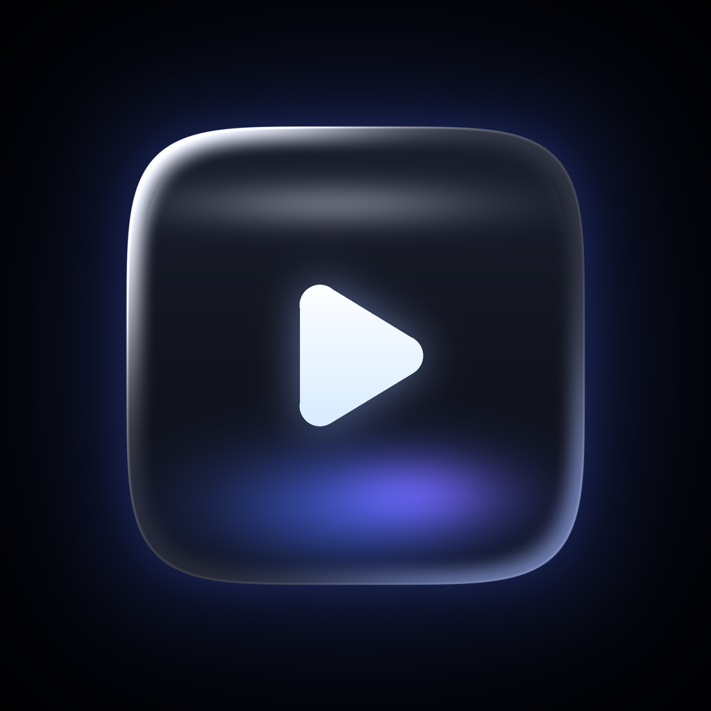
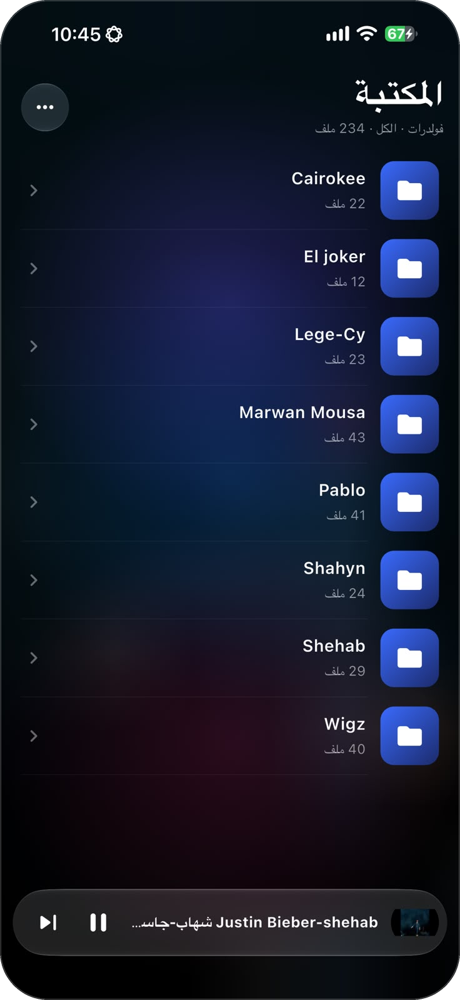
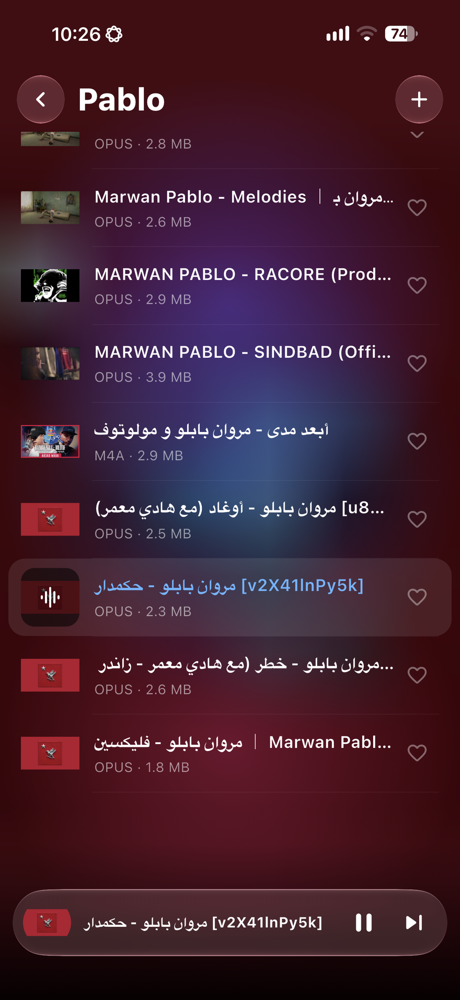
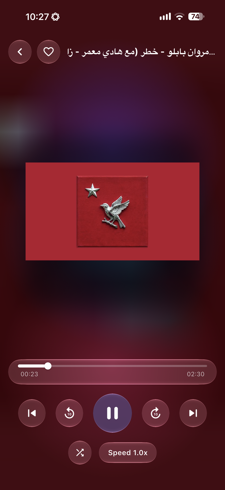
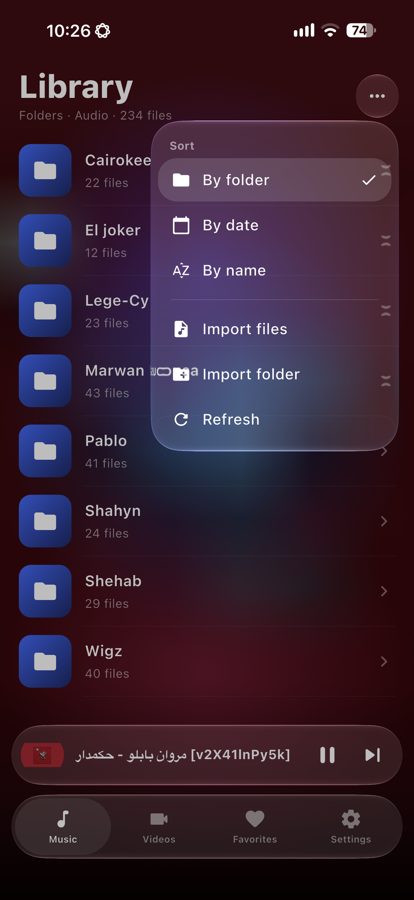

<div dir="rtl">

<p align="center">
  
</p>

<h1 align="center">Shaghal - شغل</h1>

<p align="center"><a href="README.md">English</a> · <b>العربية</b></p>

مشغّل صوت وفيديو للـ iPhone بثيم أسود وتصميم Liquid Glass، مبني بـ Flutter. بيشغّل تقريباً أي صيغة ومنها `.opus`، وبيرتّب مكتبتك زي ما بتحتفظ بيها فعلاً: **فولدر لكل فنان**.

> **الحالة: نسخة مبكرة / تجريبية.** الكود اتكتب وانعدّل بسرعة، ومش كل الميزات اتجرّبت على جهاز حقيقي لحد دلوقتي. متوقع تلاقي مشاكل، ولو قابلت واحدة افتح Issue.

## لقطات الشاشة

<p align="center">
  
  
  
  
</p>

## المميزات

- **بيشغّل (تقريباً) كل حاجة.** معتمد على [media_kit](https://pub.dev/packages/media_kit) (مبني على libmpv / FFmpeg)، فالصيغ اللي مشغّل Apple (AVPlayer) بيرفضها زي Opus وMKV وFLAC وOGG وWebM بتشتغل من غير تحويل.
- **مكتبة مبنية على الفولدرات.** الشاشة الرئيسية بتعرض فولدراتك (الفنانين). تدوس على فولدر تشوف أغانيه، والفولدرات جوّه فولدرات شغّالة كمان. وممكن تفرز قايمة واحدة بـ **التاريخ** أو **الاسم**، وتفلتر بين **صوت / فيديو**.
- **Liquid Glass حقيقي.** على iOS 26 وما بعده، الهيدر وشريط التشغيل وأزرار التحكم بتستخدم زجاج Apple النيتيف (عن طريق [liquid_design](https://pub.dev/packages/liquid_design))، وعلى الإصدارات الأقدم بيرجع لـ blur عادي.
- **ثيم أسود** مناسب لشاشات OLED، وإضاءة ملوّنة هادية بتتأثر بغلاف الأغنية الشغالة بعد ما يتعمله blur.
- **صور مصغّرة.** غلاف الألبوم المدمج لملفات الصوت، ولقطة معاينة للفيديو. الصور بتتولّد بالتدريج وبتتخزّن على الجهاز، والملف اللي من غير غلاف بياخد تدرّج لوني ثابت.
- **تحكم من Control Center وشاشة القفل.** تشغيل وإيقاف وتالي وسابق وتقديم، مع اسم الأغنية والفنان (من اسم الفولدر) والغلاف. أزرار السماعات شغّالة، والتشغيل بيقف عند المكالمات أو فصل السماعة.
- **تشغيل في الخلفية.**
- **الرجوع بالسحب من حافة الشمال.**
- **واجهة عربي وإنجليزي** بزرار واحد لتبديل اللغة (من اليمين لليسار / من اليسار لليمين).
- **تابات ومفضلة.** شريط تابات زجاجي بيقسّم **المزيكا** و**الفيديو** و**المفضلة**، وتدوس على القلب جنب أي ملف أو في شاشة التشغيل عشان تضيفه للمفضلة.
- **استيراد من جوّه التطبيق** للملفات والفولدرات، وكمان وصول من تطبيق «الملفات».

## الصيغ المدعومة

الماسح بيتعرّف على الامتدادات دي (تقدر تضيف غيرها في [`lib/core/media_formats.dart`](lib/core/media_formats.dart)). التشغيل نفسه عن طريق FFmpeg، فأي حاجة يقدر يفك تشفيرها هتشتغل.

| النوع | الامتدادات |
|-------|------------|
| صوت | mp3, m4a, aac, wav, flac, ogg, oga, **opus**, wma, aiff, aif, aifc, caf, amr, ape, wv, mka, mpc, dsf, dff, alac, mp2, ac3, eac3, dts, tta, m4b, m4r, spx, mid, midi, weba |
| فيديو | mp4, m4v, mov, mkv, avi, webm, wmv, flv, ts, mts, m2ts, 3gp, 3g2, mpg, mpeg, ogv, vob, divx, asf, rm, rmvb, f4v, mxf |

## إزاي المشروع مبني

الـ repo فيه كود Dart (`lib/`) والملفات المساعدة وسكريبتات الإعداد بس. مشروع iOS النيتيف **بيتولّد** بأمر `flutter create` لما تشغّل سكريبت الإعداد، وبعدها بتتضاف الحزم وإعدادات `Info.plist` أوتوماتيك.

| الوظيفة | المكتبة |
|---------|---------|
| التشغيل | `media_kit`, `media_kit_video`, `media_kit_libs_*` |
| إدارة الحالة | `flutter_riverpod` |
| Control Center وشاشة القفل | `audio_service`, `audio_session` |
| واجهة الزجاج | `liquid_design` |
| الأغلفة | `audio_metadata_reader` (صوت)، `video_thumbnail` (فيديو) |
| الاستيراد | `file_picker` (الإصدار 10) |
| الأيقونة | `flutter_launcher_icons` |

```
lib/
  main.dart                  نقطة البداية وتشغيل خدمة الصوت
  core/media_formats.dart    الامتدادات المعروفة
  models/media_item.dart     نماذج الأغاني والأقسام
  services/
    library_scanner.dart     مسح الفولدرات (في isolate)
    importer.dart            استيراد ملفات / فولدرات
    thumbnails.dart          الأغلفة ولقطات الفيديو وكاش على القرص
    audio_handler.dart       الربط مع Control Center وشاشة القفل
  state/providers.dart       providers والفرز والمشغّل
  ui/
    glass.dart               الخلفية والأسطح الزجاجية والصفوف
    artwork.dart             ويدجت الصورة المصغّرة مع بديل
    library_page.dart        المكتبة والفولدرات والقايمة
    now_playing.dart         شريط التشغيل وشاشة التشغيل
assets/icon/icon.png         أيقونة التطبيق (1024x1024)
setup.sh / setup.ps1         سكريبتات توليد المشروع
.github/workflows/ios.yml    البناء على CI (IPA غير موقّعة)
```

## البدء

### الطريقة (أ): بناء IPA على السحابة (من غير Mac)

1. ارفع الـ repo على GitHub.
2. افتح **Actions ← Build iOS (unsigned IPA) ← Run workflow**.
3. نزّل الملف `Shaghal-ipa` من الـ artifacts بعد ما التشغيل يخلص.

الـ workflow بيشتغل على Mac سحابي بأحدث Xcode مستقر (الزجاج النيتيف محتاج iOS 26 SDK).

### تركيب الـ IPA على iPhone من Windows أو Linux

الـ IPA **غير موقّعة**، فمحتاج أداة توقّعها بحساب Apple ID:

1. ثبّت [Sideloadly](https://sideloadly.io/) (أو AltStore). على Windows لازم iTunes وiCloud يكونوا من موقع Apple مش من Microsoft Store.
2. وصّل الـ iPhone، واسحب `Shaghal.ipa`، وادخل Apple ID وابدأ.
3. على الموبايل فعّل **الإعدادات ← الخصوصية والأمان ← Developer Mode**، وبعدها اعمل Trust للشهادة من **الإعدادات ← عام ← VPN وإدارة الجهاز**.

بحساب Apple ID مجاني التطبيق بيقف بعد **7 أيام** ولازم تعيد التوقيع. حساب Apple Developer المدفوع بيدوم سنة.

### الطريقة (ب): البناء محلياً على Mac

المتطلبات: Flutter وXcode (الإصدار 26 أو أحدث للزجاج النيتيف) وCocoaPods.

```bash
chmod +x setup.sh
./setup.sh          # يولّد app/ ويضيف الحزم ويعدّل Info.plist ويجهّز الأيقونة
cd app
flutter run         # على iPhone موصّل
```

### الطريقة (ج): معاينة الواجهة على Windows

المتطلبات: Flutter وVisual Studio مع *Desktop development with C++* وتفعيل Developer Mode في Windows.

```powershell
powershell -ExecutionPolicy Bypass -File .\setup.ps1
cd app
flutter run -d windows
```

حط ملفات التجربة في `Documents\Shaghal`. المشغّل والفولدرات والفرز والتصميم بيشتغلوا هنا. الزجاج النيتيف وأزرار Control Center وصور الفيديو المصغّرة بتاعة iOS لا.

## إضافة الموسيقى والفيديوهات

- **من التطبيق:** دوس **⋯ ← استيراد ملفات / استيراد فولدر**. هيكل الفولدرات بيتحفظ.
- **من تطبيق «الملفات»:** افتح **On My iPhone ← Shaghal** وانسخ الفولدرات جواه، وبعدها دوس **⋯ ← تحديث**. التطبيق بيعمل ملف `README.txt` صغير هناك عشان iOS يعرض الفولدر.

نصيحة: سمّي كل فولدر باسم الفنان. اسم الفولدر هو اللي بيظهر كاسم الفنان في Control Center.

## قيود معروفة

- الزجاج النيتيف محتاج iPhone على iOS 26 أو أحدث. الإصدارات الأقدم بتاخد بديل blur.
- الصور المصغّرة للفيديو على iOS بتشتغل بس مع الصيغ اللي AVFoundation بيفكها (mp4 وmov وm4v). ملفات MKV وWebM وAVI بتاخد مربع بتدرّج لوني.
- غلاف الألبوم المدمج في بعض ملفات Opus ممكن ما يتعرفش عليه.
- استيراد الفولدرات بيعتمد على صلاحية منتقي الملفات في iOS وممكن يفشل في بعض الأماكن. استيراد الملفات الفردية أضمن.
- مفيش بحث ولا shuffle ولا تكرار ولا قوايم تشغيل محفوظة لسه.
- توقيع Apple ID المجاني بينتهي بعد 7 أيام.

## أفكار للمستقبل

تشغيل الكل وshuffle لكل فولدر، وبحث، وقوايم تشغيل ومفضّلة، وتذكّر آخر موضع تشغيل، وكلمات الأغاني، ومؤقت نوم، وإكوالايزر.

## المساهمة

الـ Issues والـ Pull Requests مرحّب بيها. لو الـ build فشل، ضيف الجزء المهم من اللوج (ناتج `flutter analyze` أو الخطوة اللي فشلت في GitHub Actions).

## الرخصة

[MIT](LICENSE) © 2026 Youssef Alkhodary. استخدمه وعدّل عليه وشاركه.

</div>
