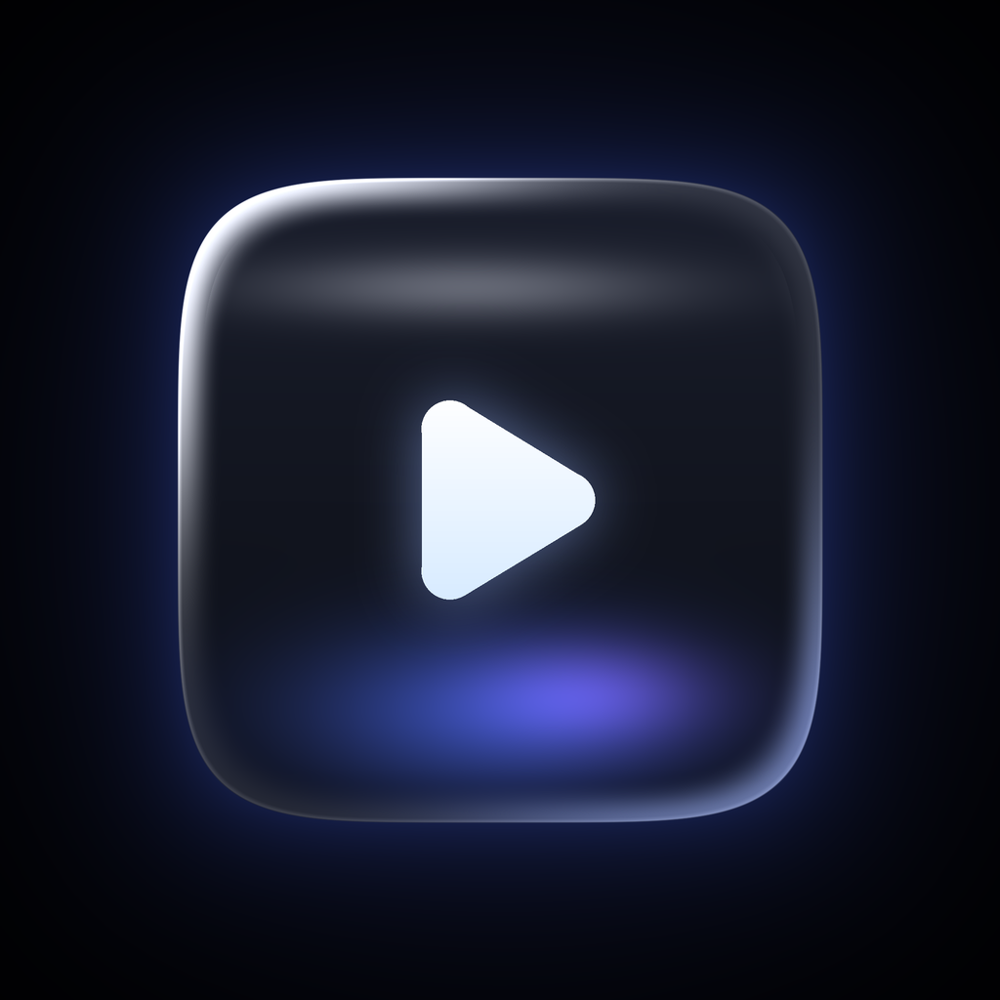
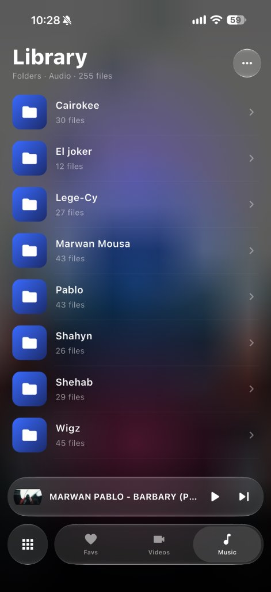
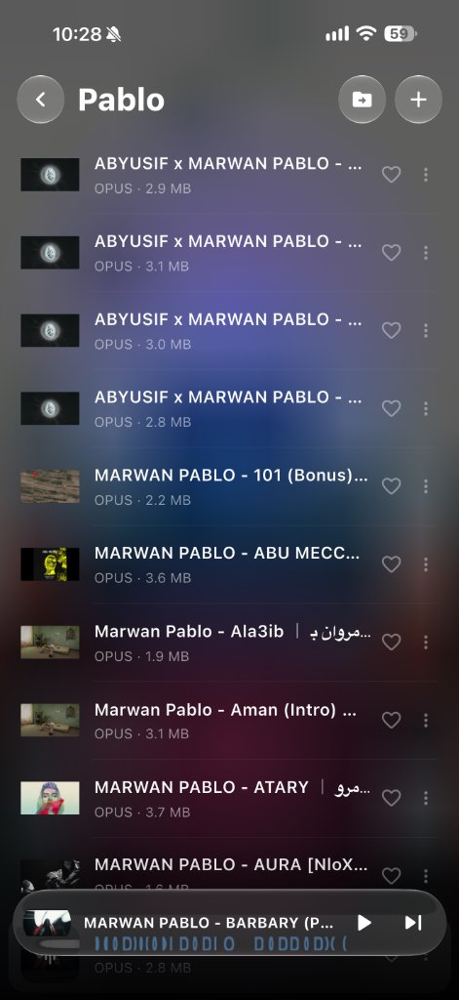
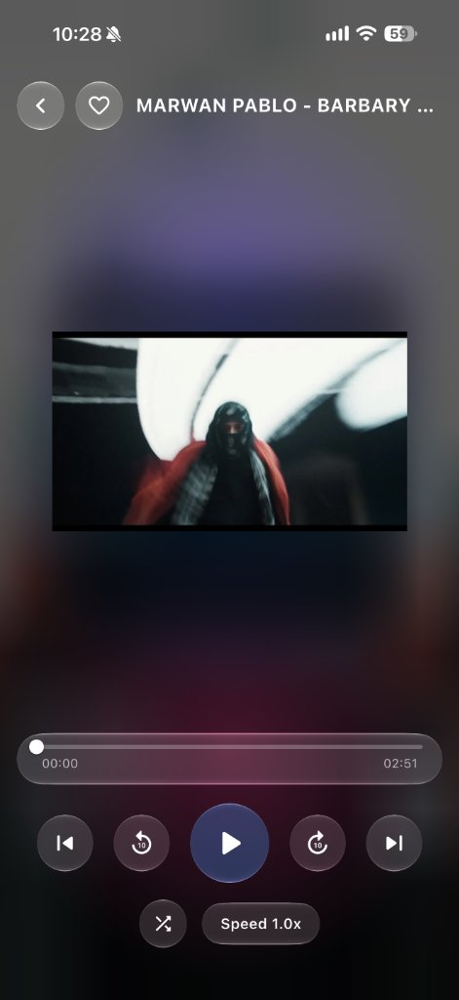
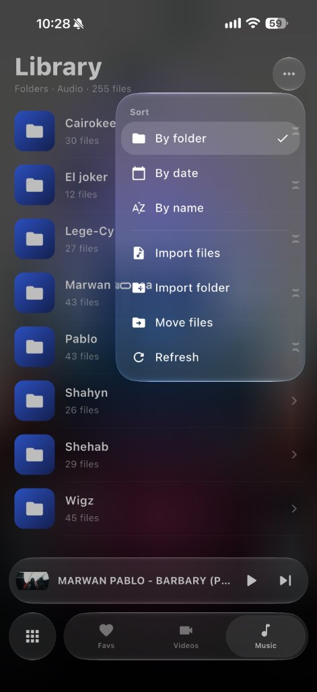
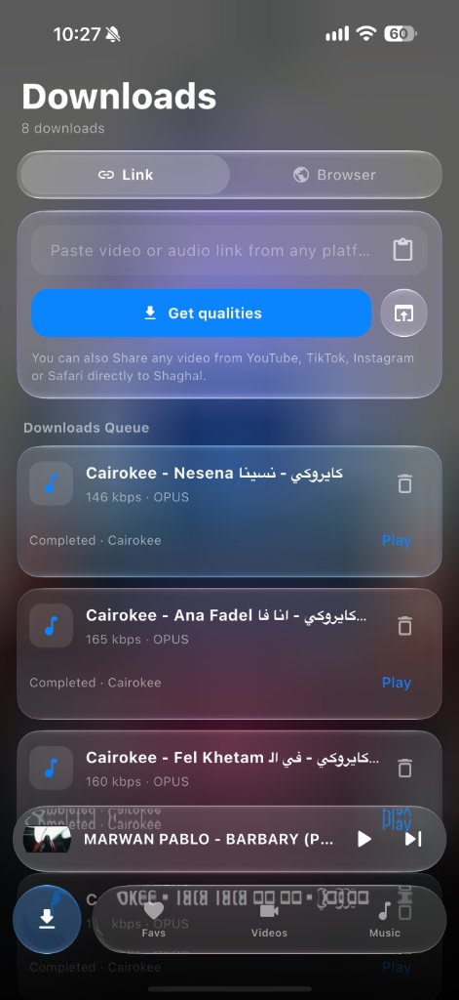
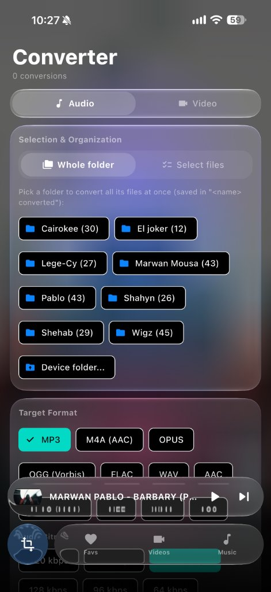
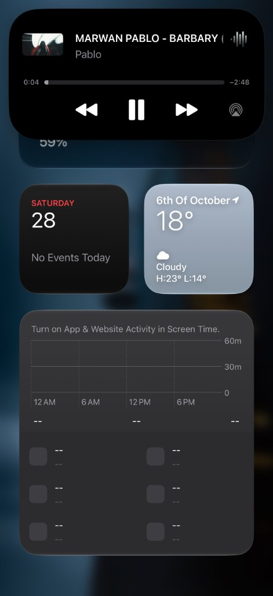

<p align="center">
  
</p>

<h1 align="center">Shaghal - شغل</h1>

<p align="center"><b>English</b> · <a href="README.ar.md">العربية</a></p>

A black, Liquid Glass audio/video player, downloader, and converter for iPhone, built with Flutter. It plays almost any format—including `.opus`, `.flac`, `.ogg`, `.mkv`, and `.webm`—and organizes your library the way you actually keep it: **one folder per artist**.

## Screenshots

<p align="center">
  
  
  
  
</p>

<p align="center">
  
  
  
</p>

## Features

- **Plays (almost) everything.** Powered by [media_kit](https://pub.dev/packages/media_kit) (libmpv / FFmpeg), so formats Apple's AVPlayer refuses—such as OPUS, MKV, FLAC, OGG, and WebM—play directly without conversion.
- **Full playback controls & persistence.** Background playback, shuffle, playback speed control (`0.5x`–`2.0x`), ±10s skip, queue playback, and automatic position/track resume across restarts and audio interruptions.
- **Folder-first library & file management.** Browse folders by artist (including nested folders), sort flat by **date** or **name**, favorite tracks, **swipe left to delete** with confirmation, and **move single or multiple files** between folders (or create new folders).
- **Real Liquid Glass & Themes.** On iOS 26+ the header, mini player, full player, context menus, and bottom bar use Apple's native glass effect (via [liquid_design](https://pub.dev/packages/liquid_design)), with **Clear / Regular** glass styles and **Dark / Light / System** appearance modes. Older iOS versions fall back to a frosted blur.
- **Built-in Downloader & Internal Browser.** Paste any link or use the in-app **Browser** tab to capture streams, choose video/audio quality, format, bitrate, and target artist folder. Supports YouTube chunked downloads, HLS streams, embedded cover art thumbnails, and an optional custom extractor API (e.g. Cobalt / yt-dlp) in Settings.
- **Multi-link iOS Share Queue.** Share multiple links back-to-back from YouTube, Safari, TikTok, or Instagram (`Share → Shaghal`) without leaving the source app. Links queue up in Shaghal, fetch qualities in the background, and let you step through them **one by one** (`Configure all`) to pick format, quality, and folder.
- **Batch Audio & Video Converter.** Powered by FFmpeg (`ffmpeg_kit_flutter_new`). Convert whole folders at once (saved to `<Folder> converted`) or select individual tracks/device files between `MP3`, `M4A (AAC)`, `OPUS`, `OGG (Vorbis)`, `FLAC`, `WAV`, `AAC`, `MP4`, `MKV`, `MOV`, `WEBM`, `AVI`, and more.
- **Thumbnails & Control Center.** Embedded cover art for audio files, frame previews for videos (cached on disk), Control Center / Lock Screen controls with artist metadata (taken from folder name), AirPlay output, and headphone button support.
- **Arabic & English UI.** Instant language toggle with full RTL / LTR layout support.
- **In-app & Files-app import.** Import files or folders inside the app, or manage files directly via **Files → On My iPhone → Shaghal**.

## Supported formats

The scanner recognizes these extensions (you can add more in [`lib/core/media_formats.dart`](lib/core/media_formats.dart)). Playback itself is handled by FFmpeg, so anything FFmpeg decodes will work.

| Type  | Extensions |
|-------|------------|
| Audio | mp3, m4a, aac, wav, flac, ogg, oga, **opus**, wma, aiff, aif, aifc, caf, amr, ape, wv, mka, mpc, dsf, dff, alac, mp2, ac3, eac3, dts, tta, m4b, m4r, spx, mid, midi, weba |
| Video | mp4, m4v, mov, mkv, avi, webm, wmv, flv, ts, mts, m2ts, 3gp, 3g2, mpg, mpeg, ogv, vob, divx, asf, rm, rmvb, f4v, mxf |

## How it is built

The repository holds the Dart source (`lib/`), assets, native iOS Share Extension / AVFoundation bridge templates (`ios_templates/`), and project setup scripts. Running `setup.sh` or `setup.ps1` generates `app/` via `flutter create`, adds packages, patches `Info.plist`, and configures the Share Extension target.

| Concern | Library / Component |
|---------|---------------------|
| Playback | `media_kit`, `media_kit_video`, `media_kit_libs_*` |
| State | `flutter_riverpod` |
| Control Center / Lock Screen | `audio_service`, `audio_session` |
| Glass UI | `liquid_design` |
| Downloader & Extractor | `youtube_explode_dart`, `dio`, `webview_flutter`, `app_links` |
| Audio / Video Converter & Muxing | `ffmpeg_kit_flutter_new` + native `ShaghalBridge.swift` |
| Cover art & Thumbnails | `audio_metadata_reader`, `video_thumbnail` |
| Share Extension | `ios_templates/ShareExtension/ShareViewController.swift` (App Group queue) |
| Import & Icon | `file_picker` (v10), `flutter_launcher_icons` |

```text
lib/
  main.dart                    app entry, deep links & share queue listener
  core/media_formats.dart      recognized audio/video extensions
  models/
    media_item.dart            track and folder/section models
    download_item.dart         download tasks, extracted formats, pending share queue
    convert_item.dart          conversion job and format presets
  services/
    library_scanner.dart       recursive folder scan (isolate)
    importer.dart              import files and folders
    thumbnails.dart            cover art + video frames, disk cache
    audio_handler.dart         Control Center / lock screen bridge
    media_extractor.dart       stream extraction & quality parsing
    download_manager.dart      pending share queue, chunked/HLS downloads, artwork tagging
    hls_downloader.dart        HLS playlist downloader
    media_converter.dart       FFmpeg batch converter
    native_bridge.dart         MethodChannel & App Group share queue bridge
  state/providers.dart         Riverpod providers, sorting, favorites, player & file actions
  ui/
    glass.dart                 background, native glass surfaces, tiles
    artwork.dart               thumbnail widget with gradient fallback
    library_page.dart          library, folders, swipe delete, file mover, settings
    now_playing.dart           mini player and full player (speed, shuffle, seek)
    download_page.dart         downloader, internal browser, multi-share queue UI
    converter_page.dart        batch audio/video converter UI
    legal_page.dart            terms page
ios_templates/
  Runner/ShaghalBridge.swift   AVFoundation muxing/extraction + App Group bridge
  ShareExtension/              iOS Share Sheet target appending URLs to queue
  configure_ios.rb             Xcodeproj target, entitlements & build phase setup
assets/icon/icon.png           app icon (1024x1024)
setup.sh / setup.ps1           project generation scripts
.github/workflows/ios.yml      CI build (unsigned IPA)
```

## Getting started

### Option A: build an IPA in the cloud (no Mac needed)

1. Push this repository to GitHub.
2. Open **Actions → Build iOS (unsigned IPA) → Run workflow**.
3. Download the `Shaghal-ipa` artifact when the run finishes.

The workflow runs on a macOS runner with the latest stable Xcode (native Liquid Glass requires the iOS 26 SDK).

### Install the IPA on your iPhone from Windows or Linux

The IPA is **unsigned**, so sign it with your Apple ID:

1. Install [Sideloadly](https://sideloadly.io/) (or AltStore). On Windows, iTunes and iCloud must come from Apple's site, not the Microsoft Store.
2. Connect your iPhone, drag in `Shaghal.ipa`, enter your Apple ID, and start.
3. On iPhone enable **Settings → Privacy & Security → Developer Mode**, then trust your certificate in **Settings → General → VPN & Device Management**.

With a free Apple ID the signature expires after **7 days**. A paid Apple Developer account lasts a year.

### Option B: build locally on a Mac

Requirements: Flutter, Xcode (26 or newer for native glass), CocoaPods.

```bash
chmod +x setup.sh
./setup.sh          # generates app/, adds packages, configures ShareExtension, builds icon
cd app
flutter run --release
```

> **Note:** When updating `app/` after modifying code in `lib/`, copy `lib/.` to `app/lib/` and install updates in-place with `xcrun devicectl device install app --device <UDID> build/ios/iphoneos/Runner.app` (avoid `flutter install`, which uninstalls first and wipes local sandbox files).

### Option C: preview the UI on Windows

Requirements: Flutter, Visual Studio with *Desktop development with C++*, Windows Developer Mode.

```powershell
powershell -ExecutionPolicy Bypass -File .\setup.ps1
cd app
flutter run -d windows
```

Put test files in `Documents\Shaghal`. The player, folders, sorting, and layout work here. Native Liquid Glass, Control Center controls, iOS Share Extension, and iOS thumbnails do not.

## Adding your music and videos

- **Share from another app:** Tap **Share → Shaghal** in YouTube, Safari, TikTok, or Instagram. Share as many links in a row as you like, then open **Shaghal → Download** and tap **Configure all** to choose format, quality, and folder for each item.
- **In-app Download / Browser:** Paste a URL or browse directly inside the **Download** tab.
- **In-app Import:** Tap **⋯ → Import files / Import folder**. Folder structure is preserved.
- **From the Files app:** Open **On My iPhone → Shaghal** and copy folders in, then tap **⋯ → Refresh**.

Tip: name each folder after the artist. The folder name is shown as the artist in Control Center.

## Known limitations

- Native Liquid Glass requires iOS 26 or newer on the device. Older versions get a frosted fallback.
- Video thumbnails on iOS only generate for formats AVFoundation decodes (`mp4`, `mov`, `m4v`). `mkv`, `webm`, and `avi` show a gradient placeholder.
- Standalone Apple CarPlay app icon requires the `com.apple.developer.carplay-audio` entitlement (needs a paid Apple Developer Program account and Apple's CarPlay approval); Control Center / standard audio playback over CarPlay still works as system audio.
- Folder import relies on the iOS document picker's security-scoped access and may fail for some locations; importing individual files is more reliable.
- No search, repeat modes, custom playlists, lyrics, or equalizer yet.
- A free Apple ID signature expires after 7 days.

## Roadmap ideas

In-library search, repeat modes, custom playlists, lyrics, sleep timer, equalizer, and CarPlay template support.

## Contributing

Issues and pull requests are welcome. If a build fails, include the relevant part of the log (`flutter analyze` output or the failing GitHub Actions / Xcode step).

## License

[MIT](LICENSE) © 2026 Youssef Alkhodary. Use it, modify it, share it.
