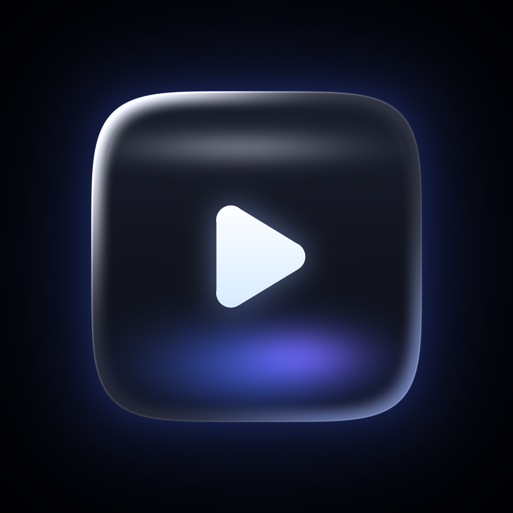
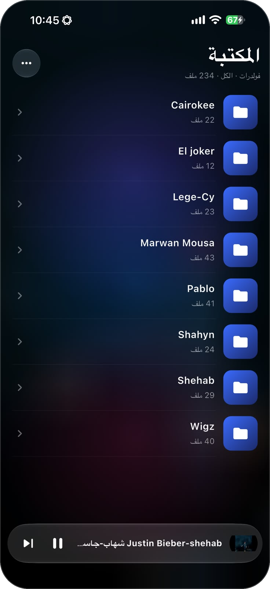
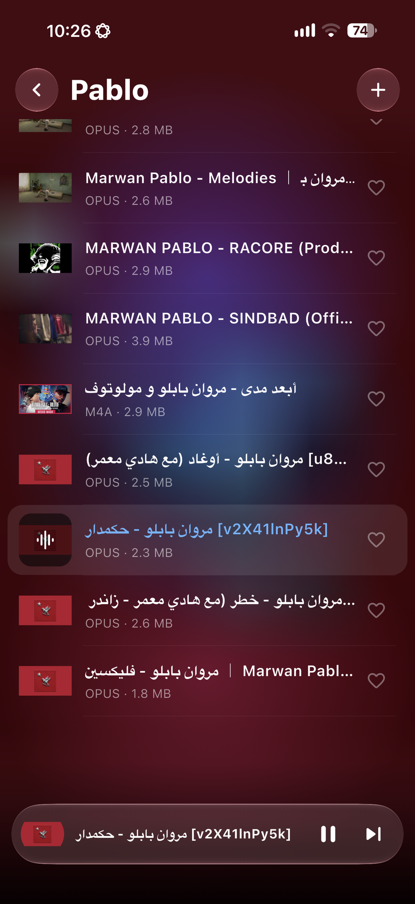
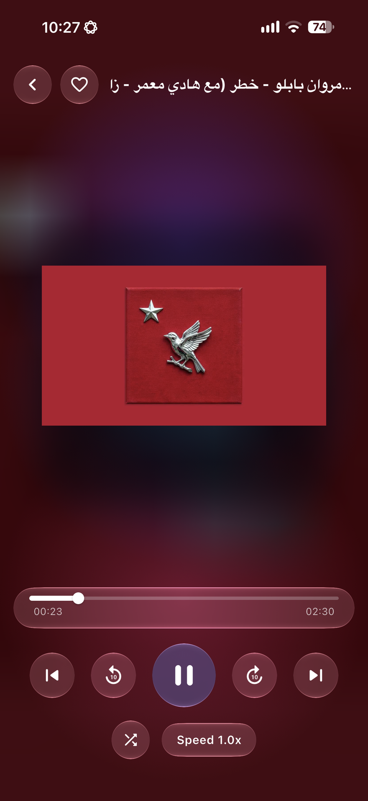
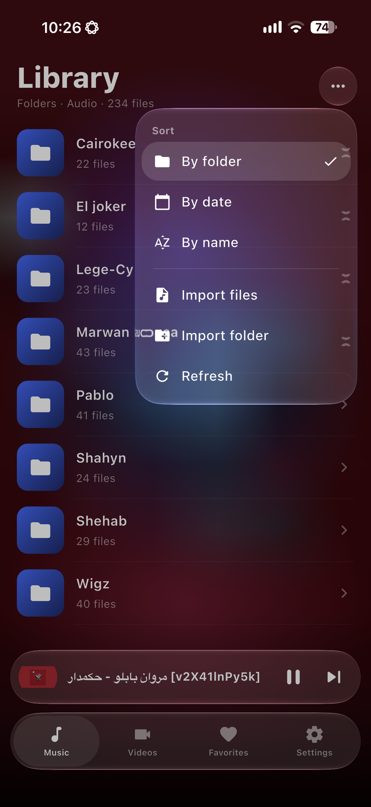

<p align="center">
  
</p>

<h1 align="center">Shaghal - شغل</h1>

<p align="center"><b>English</b> · <a href="README.ar.md">العربية</a></p>

A black, Liquid Glass audio and video player for iPhone, built with Flutter. It plays almost any format, including `.opus`, and it organizes your library the way you actually keep it: **one folder per artist**.

> **Status: early / experimental.** The code has been written and iterated quickly, but not every feature has been tested on a device yet. Expect rough edges and please open an issue when you hit one.

## Screenshots

<p align="center">
  
  
  
  
</p>

## Features

- **Plays (almost) everything.** Powered by [media_kit](https://pub.dev/packages/media_kit) (libmpv / FFmpeg), so formats Apple's AVPlayer refuses, such as Opus, MKV, FLAC, OGG and WebM, play without conversion.
- **Folder-first library.** The home screen lists your folders (artists). Tap one to see its tracks. Nested folders work too. You can also sort flat by **date** or **name**, and filter by **audio / video**.
- **Real Liquid Glass.** On iOS 26+ the header, mini player and player controls use Apple's native glass effect (via [liquid_design](https://pub.dev/packages/liquid_design)). On older iOS versions it falls back to a frosted blur.
- **Black, OLED-friendly theme** with a soft colored glow that picks up the blurred cover art of the current track.
- **Thumbnails.** Embedded cover art for audio files, and a frame preview for videos. Thumbnails are generated lazily and cached on disk. Files without art get a stable gradient.
- **Control Center and lock screen controls.** Play, pause, next, previous and seeking, with title, artist (taken from the folder name) and artwork. Headphone buttons work, and playback pauses on calls or when headphones are unplugged.
- **Background playback.**
- **Swipe from the left edge to go back.**
- **Arabic and English UI** with a one-tap language switch (right-to-left / left-to-right).
- **Tabs and favorites.** A glass tab bar splits **Music**, **Videos** and **Favorites**; tap the heart on any track or in the player to favorite it.
- **In-app import** of files and folders, plus Files-app access to the app's folder.

## Supported formats

The scanner recognizes these extensions (add more in [`lib/core/media_formats.dart`](lib/core/media_formats.dart)). Playback itself is handled by FFmpeg, so anything FFmpeg can decode will work.

| Type  | Extensions |
|-------|------------|
| Audio | mp3, m4a, aac, wav, flac, ogg, oga, **opus**, wma, aiff, aif, aifc, caf, amr, ape, wv, mka, mpc, dsf, dff, alac, mp2, ac3, eac3, dts, tta, m4b, m4r, spx, mid, midi, weba |
| Video | mp4, m4v, mov, mkv, avi, webm, wmv, flv, ts, mts, m2ts, 3gp, 3g2, mpg, mpeg, ogv, vob, divx, asf, rm, rmvb, f4v, mxf |

## How it is built

The repository contains only the Dart sources (`lib/`), assets and setup scripts. The native iOS project is **generated** by `flutter create` when you run a setup script, then packages and `Info.plist` settings are applied automatically.

| Concern | Library |
|---------|---------|
| Playback | `media_kit`, `media_kit_video`, `media_kit_libs_*` |
| State | `flutter_riverpod` |
| Control Center / lock screen | `audio_service`, `audio_session` |
| Glass UI | `liquid_design` |
| Cover art | `audio_metadata_reader` (audio), `video_thumbnail` (video) |
| Import | `file_picker` (v10) |
| Icon | `flutter_launcher_icons` |

```
lib/
  main.dart                  app entry, audio service setup
  core/media_formats.dart    recognized extensions
  models/media_item.dart     track and section models
  services/
    library_scanner.dart     recursive folder scan (isolate)
    importer.dart            import files / folders
    thumbnails.dart          cover art + video frames, disk cache
    audio_handler.dart       Control Center / lock screen bridge
  state/providers.dart       Riverpod providers, sorting, player
  ui/
    glass.dart               background, glass surfaces, tiles
    artwork.dart             thumbnail widget with fallback
    library_page.dart        library, folders, menu
    now_playing.dart         mini player and full player
assets/icon/icon.png         app icon (1024x1024)
setup.sh / setup.ps1         project generation scripts
.github/workflows/ios.yml    CI build (unsigned IPA)
```

## Getting started

### Option A: build an IPA in the cloud (no Mac needed)

1. Push this repository to GitHub.
2. Open **Actions → Build iOS (unsigned IPA) → Run workflow**.
3. Download the `Shaghal-ipa` artifact when the run finishes.

The workflow runs on a macOS runner with the latest stable Xcode (native Liquid Glass needs the iOS 26 SDK).

### Install the IPA on your iPhone from Windows or Linux

The IPA is **unsigned**, so you need a tool that signs it with your Apple ID:

1. Install [Sideloadly](https://sideloadly.io/) (or AltStore). On Windows, iTunes and iCloud must come from Apple's site, not the Microsoft Store.
2. Connect your iPhone, drag in `Shaghal.ipa`, enter your Apple ID and start.
3. On the iPhone enable **Settings → Privacy & Security → Developer Mode**, then trust your certificate in **Settings → General → VPN & Device Management**.

With a free Apple ID the app stops working after **7 days** and must be re-signed. A paid Apple Developer account lasts a year.

### Option B: build locally on a Mac

Requirements: Flutter, Xcode (26 or newer for native glass), CocoaPods.

```bash
chmod +x setup.sh
./setup.sh          # generates app/, adds packages, patches Info.plist, builds the icon
cd app
flutter run         # on a connected iPhone
```

### Option C: preview the UI on Windows

Requirements: Flutter, Visual Studio with *Desktop development with C++*, Windows Developer Mode.

```powershell
powershell -ExecutionPolicy Bypass -File .\setup.ps1
cd app
flutter run -d windows
```

Put test files in `Documents\Shaghal`. The player, folders, sorting and layout work here. Native Liquid Glass, Control Center controls and iOS thumbnails do not.

## Adding your music and videos

- **In the app:** tap **⋯ → Import files / Import folder**. Folder structure is preserved.
- **From the Files app:** open **On My iPhone → Shaghal** and copy folders in, then tap **⋯ → Refresh**. The app creates a small `README.txt` there so iOS shows the folder.

Tip: name each folder after the artist. The folder name is shown as the artist in Control Center.

## Known limitations

- Native Liquid Glass requires iOS 26 or newer on the device. Older versions get a frosted fallback.
- Video thumbnails on iOS only work for formats AVFoundation can decode (mp4, mov, m4v). MKV, WebM and AVI show a gradient placeholder.
- Cover art embedded in some Opus files may not be detected.
- Folder import relies on the iOS document picker's security-scoped access and may fail for some locations. Importing individual files is more reliable.
- No search, shuffle, repeat or saved playlists yet.
- A free Apple ID signature expires after 7 days.

## Roadmap ideas

Play all and shuffle per folder, search, playlists and favorites, remember the last position, lyrics, sleep timer, equalizer.

## Contributing

Issues and pull requests are welcome. If a build fails, include the relevant part of the log (`flutter analyze` output or the failing GitHub Actions step).

## License

[MIT](LICENSE) © 2026 Youssef Alkhodary. Use it, modify it, share it.
